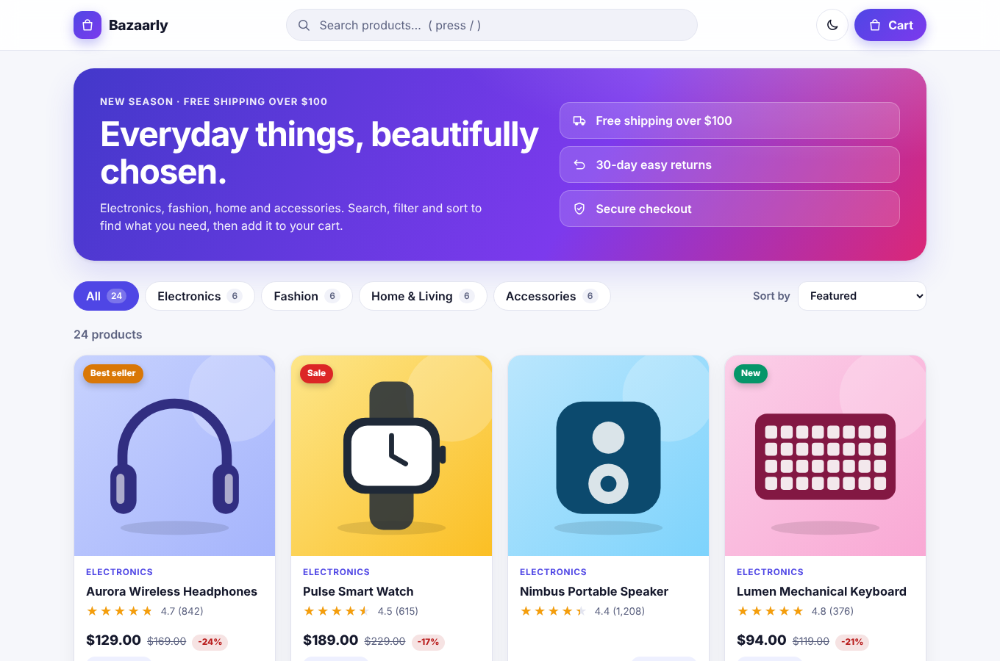
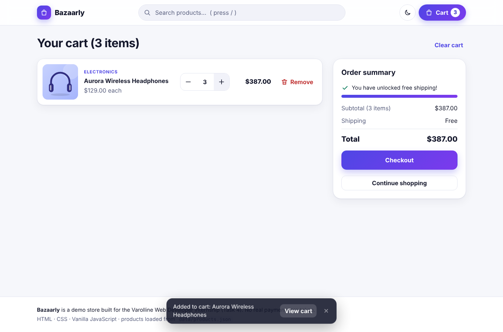
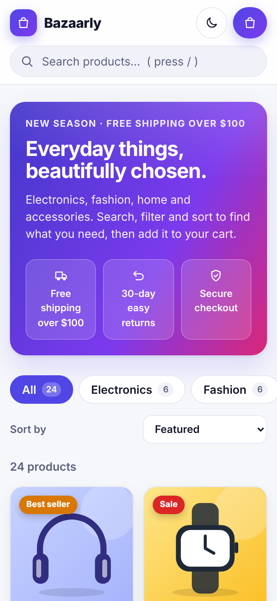

# Bazaarly: Product Catalog with Shopping Cart

A responsive e-commerce front end with product listing, search, category filter, price sorting, product details and a shopping cart that **survives a page refresh**.
Built for the Varolline Web Developer internship (Task 4) with plain **HTML, CSS and JavaScript**: no framework, no build step.

**Author:** Mahin Saleem 
**Repository:** https://github.com/mahinsaleem001-debug/Web_Developer_Varolline_Task4  
**Live demo:** https://mahinsaleem001-debug.github.io/Web_Developer_Varolline_Task4/



## Requirements checklist

| Requirement | How it is delivered |
|---|---|
| Product listing page | Responsive grid of 24 products (4 / 3 / 2 columns by screen width) with badges, ratings, prices and discounts |
| Search | Instant search in the header across name, category, description and features. Every word must match. Press `/` to focus, `Esc` to clear |
| Category filter | Category chips with live counts that follow the search text |
| Sorting by price | Price low to high, high to low (plus Featured, Top rated, Name A to Z) |
| Product details page | Large image, rating, price, features, stock status, quantity picker, related products |
| Cart: change quantity | `+` / `-` buttons or type a number. Limited by stock and 10 per order |
| Cart: remove items | Remove button with an **Undo** toast, and Clear cart (also undoable) |
| Cart: total | Subtotal, shipping (free over $100, with a progress bar) and total |
| Kept after refresh | Saved in `localStorage` and cleaned on load; also synced between open tabs |
| JSON file for data | All products come from `data/products.json` via `fetch()` |

### Extras
Light and dark theme, loading skeletons, friendly error screen, demo checkout dialog, filters kept in the URL (shareable links), keyboard and screen reader support, respects "reduce motion".

## Screenshots

| Product page | Cart | Mobile |
|---|---|---|
|  |  |  |

## Run it

The products are loaded with `fetch()`, and browsers block that for files opened by double-click (`file://`). So use a tiny local server:

**VS Code:** install the *Live Server* extension, right-click `index.html`, **Open with Live Server**.

**Or with Node.js:**
```bash
npm start        # serves http://localhost:8080
```

**Or with Python:**
```bash
python -m http.server 8080
```

Run the unit tests (Node 18+, nothing to install):
```bash
npm test
```

### Live link with GitHub Pages
Repository **Settings → Pages → Source: Deploy from a branch → `main` / `(root)` → Save**. After about a minute the site is live at the URL above.

## Project structure

```
index.html            Page shell and icon sprite
css/style.css         Design tokens (light/dark), layout, components, responsive rules
data/products.json    The product data (24 products)
js/catalog.js         Pure logic: normalize, search, filter, sort, URL query, price format
js/cart.js            Pure logic: add, set quantity, remove, totals, saved-cart cleanup
js/art.js             SVG product illustrations (no photo files needed)
js/app.js             UI: router, rendering, events, toasts, checkout dialog, theme
tests/shop.test.js    16 unit tests for catalog and cart logic
screenshots/          Images used in this README
```

## How it works (short version)

- **Data:** `app.js` fetches `data/products.json`, and `normalizeProducts()` removes bad rows. To use a real API, change the one `fetch()` URL in `boot()`.
- **Routing:** a hash router (`#/`, `#/product/p01`, `#/cart`) so it works on any static host. Search, category and sort are stored in the URL.
- **Cart logic is pure.** `cart.js` functions take a cart and return a new one, so they are easy to test. A cart is just `[{ id, qty }]`; prices are always read from the catalogue, so a stored cart can never carry a wrong price.
- **Money in cents.** Prices are converted to whole cents, which avoids floating point errors such as `0.1 + 0.2`.
- **Persistence:** every change is saved to `localStorage` under `bazaarly-cart-v1`. On load, `sanitize()` drops unknown products, fixes quantities and merges duplicates, so corrupted data cannot break the page. Storage errors (private mode) are caught.
- **Safe rendering:** all text is added with `textContent` through the `el()` helper, never `innerHTML`.
- **Accessible:** skip link, labelled controls, `aria-pressed` filters, live announcements for cart changes, focus kept after cart edits, native `<dialog>` for checkout.

## Tech

HTML5 · CSS3 (custom properties, Grid, Flexbox) · Vanilla JavaScript (ES2020) · Node's built-in test runner

## AI tool usage

This project was built with assistance from an AI tool (Claude). All code was reviewed, run and tested by me, and I can explain how each part works.
